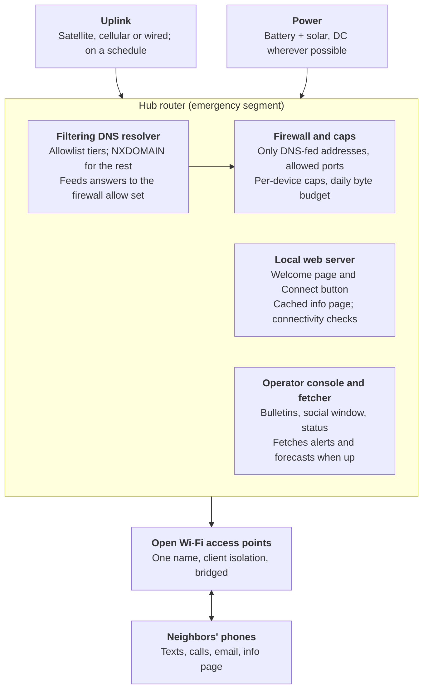

# Neighborhood Emergency Communications Hub: Technology-Agnostic Plan

_Last updated: Nov 25, 2026_

## Purpose and scope

When cell towers and home internet are down, one household with a satellite (or other) uplink can give a whole neighborhood a way to say "we're OK" or "we need help" and to read official updates. The trick is to carry only low-bandwidth messaging and information, so a small data plan and a battery last for days. This plan describes the roles and rules; any router, firewall, DNS server and web server that can fill those roles will work.

**What the hub provides**

- Open Wi-Fi anyone nearby can join with no password.
- Regular SMS texting (through carrier Wi-Fi calling), RCS (Rich Communication Services) chat, iMessage, WhatsApp and Signal.
- Email through mail apps.
- A locally hosted information page with official alerts, forecasts and operator bulletins.
- Optional, time-limited access to Facebook and X.

**What it deliberately does not provide:** video, streaming, web browsing in general, photo backup, app or operating system updates, gaming or VPNs (virtual private networks).

**Design principles**

1. **Deny by default.** Only named services work; everything else fails fast so phones don't keep retrying.
2. **Fetch once, serve many.** Information is pulled over the uplink by one machine and served locally to everyone.
3. **Every device gets a fair, small share.** Per-device speed caps keep one phone from starving the rest.
4. **Budget the data and the power, and enforce both automatically.**
5. **Stay useful when the uplink is off.** Local services keep working; messages queue and send when the link returns.
6. **Simple for neighbors.** One network name, one button, plain instructions.

## Architecture

Seven parts; the four inside the hub can live on one router or be split across a router and a small computer.

Phones join the open access points, which bridge back to the hub so every device passes the same resolver and firewall. The web server and operator tools work even when the uplink is off.

## Uplink and data budget

Set a daily data budget from the monthly allowance and enforce it automatically. A 100 GB/month plan allows about 3,300 MB a day; budget 3,000 MB and keep the rest as reserve.

**Uplink options:** satellite internet, a cellular hotspot on a carrier or tower that's still up, a neighbor's surviving wired line, or amateur radio data (for example Winlink) as a last-resort email path. A low-power satellite terminal is ideal because it can run from a battery on DC (direct current) power.

**Where data goes (typical, per use)**

| Activity | Approximate data |
| --- | --- |
| SMS text over Wi-Fi calling | Under 5 KB |
| RCS, iMessage or WhatsApp text | 5–20 KB |
| Plain-text email | 10–50 KB |
| Wi-Fi voice call | About 0.5–1 MB per minute |
| Cached info page, served locally | 0 (uplink cost only at refresh) |
| Social media feed, text and images | 2–10 MB per few minutes |
| One app update or photo backup | 100 MB to several GB |

The last row is why background traffic, not messaging, is the real threat to the budget.

**Budget rules to implement**

- Count bytes for the hub's clients only (not the operator's own devices).
- At about 50% of the daily budget, close optional tiers such as social media.
- At 100%, tighten per-device caps until the day resets.
- Log daily totals so you can tune the numbers after a drill.
- Run the uplink on a schedule if power or data is tight, and publish that schedule to users.

## Power planning and sizing

Size power for your worst season, not your average one; in cloudy winters, solar may cover only a fraction of the load. Keep the local network on all day and switch the uplink on in windows, because the uplink is usually the largest load.

**Size it in four steps**

1. **List loads in watts:** uplink terminal, main router, each extender, any small server. Measure with a USB or inline power meter rather than trusting labels.
2. **Pick a schedule** (for example, the local network 8 AM–3 PM, or always on with the uplink 20 minutes each hour).
3. **Daily use (Wh)** = sum of each load × hours on. Add 10–20% if anything runs through an AC (alternating current) inverter.
4. **Days of autonomy** = usable battery Wh ÷ (daily use − expected daily solar Wh). Use about 90% of a lithium iron phosphate (LiFePO4) battery's rated capacity as usable.

**Worked example:** a 35 W satellite terminal plus 11 W of routers for 7 hours uses about 320 Wh a day. 100 W of panel in a cloudy winter yields about 125 Wh a day, so a 920 Wh usable battery lasts about 4.7 days. Adding 200 W more panel roughly covers the daily use.

**Practical rules**

- Run everything on DC where you can (USB-C Power Delivery or 12 V). Inverters waste power even when idle.
- More panel often beats more battery; with storage, the limit becomes how much you can recharge each day.
- Respect the charge controller's limits: maximum open-circuit voltage (with a cold-weather margin of about 10%), maximum current per input and total watts.
- Lithium batteries can't charge below freezing; keep them indoors or use self-heating models.
- Arrange a generator top-up with a neighbor for long dark stretches.
- Write down a battery reserve rule in advance (for example, below 30%, cut uplink windows to two a day).

## Local Wi-Fi coverage

One open network name everywhere, bridged back to the hub so every device is filtered in one place. Height beats extra hardware: one access point in an upstairs window or on a mast covers more than several at ground level.

- **Network name:** obvious and self-explaining, for example `EMERGENCY-WIFI open info.lan`. No password.
- **Isolation:** turn on client isolation so neighbors' phones can't see each other.
- **Separate segment:** keep the emergency network on its own subnet and VLAN (virtual LAN), apart from your household network and the uplink equipment's admin pages.
- **IPv4 only:** simplest to filter. Disable IPv6 addressing on this segment unless your firewall filters IPv6 just as strictly.
- **Extenders:** prefer wired backhaul (Ethernet to a dumb access point). For wireless backhaul use a bridging mode (WDS, mesh) so clients still get addresses from the hub; a routed or NAT (network address translation) extender hides individual phones behind one address and breaks per-device limits.
- **Capacity:** small consumer radios handle roughly 30–60 active phones each. Add access points before you add users.
- **Protect the uplink:** hide or password-protect the uplink's own Wi-Fi so nobody can bypass the filter.
- **Lock down extenders:** strong admin passwords, since their admin pages sit on the open segment.

Open Wi-Fi is unencrypted over the air. That's acceptable here because the allowed services (Wi-Fi calling, messaging apps, mail apps) encrypt their own traffic. OWE (Opportunistic Wireless Encryption, "Enhanced Open") adds encryption without a password, but older phones may not support it; offer it only as a second network if you use it.

## Traffic policy

Allow by name, block by default, and only let devices reach addresses that the hub's own DNS (Domain Name System) just handed them. This one rule defeats hard-coded IPs, encrypted DNS, VPNs and most background traffic.

### Five controls

1. **Filtering DNS resolver for the emergency segment.** Answer "does not exist" (NXDOMAIN) for every name except an allowlist; forward allowlisted names upstream. Force all DNS traffic from clients to this resolver.
2. **DNS-fed firewall allowlist.** Each address the resolver returns for an allowlisted name is added to a firewall set with a timeout (about 6 hours). Clients may open new connections only to addresses in that set, only on the ports below. Block traffic to private and local address ranges.
3. **Per-device speed caps.** About 256 kbps down and 128 kbps up per device (enough for a Wi-Fi call or email; too slow for video). A tighter cap for the social tier.
4. **Daily byte budget** with automatic tier shut-off and tighter caps (see Uplink and data budget).
5. **Tell devices to save data.** Hand out DHCP (Dynamic Host Configuration Protocol) option 43 with the text `ANDROID_METERED` so Android treats the network as metered; ask iPhone users to turn on Low Data Mode.

### Service tiers

| Tier | Services | Default |
| --- | --- | --- |
| Core | Carrier Wi-Fi calling (SMS, voice, 911); carrier account and E911 address pages; RCS; Apple and Google push and sign-in; iMessage; WhatsApp; Signal; government, weather and utility sites | Always on |
| Mail | Major email providers' IMAP/SMTP (mail retrieval and sending) and sign-in endpoints | Always on |
| Social | Facebook, Messenger, X; video hosts blocked where they're separate | Off; opened in timed windows |

### Starter allowlist (verify with test phones)

- **Wi-Fi calling:** `pub.3gppnetwork.org` and subdomains (carrier gateways); UDP ports 500 and 4500 plus the ESP (Encapsulating Security Payload) protocol.
- **RCS / Google Messages:** `jibe.google.com`, `telephony.goog`, `instantmessaging-pa.googleapis.com`.
- **Google sign-in and push:** `accounts.google.com`, `oauth2.googleapis.com`, `www.googleapis.com`, `android.googleapis.com`, `android.clients.google.com`, `fcm.googleapis.com`, `mtalk.google.com` (ports 5228–5230).
- **Apple push and iMessage:** `push.apple.com`, `ess.apple.com` (port 5223).
- **Messaging apps:** `whatsapp.com`, `whatsapp.net`, `signal.org`.
- **Email:** each provider's IMAP and SMTP hosts plus its sign-in domain.
- **Information:** national weather and emergency agencies, your county, cities and utilities, plus each carrier's account site.
- **Always block:** Apple's iCloud Private Relay names (`mask.icloud.com`, `mask-h2.icloud.com`) and Firefox's encrypted-DNS check (`use-application-dns.net`). Blocking these makes devices fall back to normal DNS.

**Allowed ports to allowlisted addresses:** TCP (Transmission Control Protocol) 80, 443, 465, 587, 993, 995, 5222, 5223, 5228–5230; UDP (User Datagram Protocol) 443, 500, 3478–3481, 4500; ESP.

App domains change. Build in a **discovery mode** that logs every refused name, test with real phones, and add what's legitimate.

## Onboarding and welcome page

Use a one-tap captive portal that explains the rules, then answer phones' connectivity checks locally so they stay "online" even while the uplink is off.

**How it should behave**

1. A new device's web requests (port 80) are redirected to a local welcome page. Phones show it automatically as a "sign in to network" sheet.
2. The page has one **Connect** button. Tapping it adds the device's address to an authorized set for about 12 hours.
3. Devices that haven't tapped Connect get DNS, DHCP and the welcome page only.
4. The hub's resolver points the operating systems' connectivity-check names at the local server, which returns the expected "success" answer for authorized devices: `captive.apple.com` (Apple), `connectivitycheck.gstatic.com` and `connectivitycheck.android.com` (Android), `www.msftconnecttest.com` (Windows), `detectportal.firefox.com` (Firefox). Phones then stay connected between uplink windows and send queued messages as soon as the link returns.
5. Android also checks over HTTPS (`www.google.com`); allowlist it, and accept that Android may show "no internet" while the uplink is off.

**Welcome page content (keep it under one screen)**

- What this network is for and what's blocked.
- The uplink schedule.
- How to turn on Wi-Fi calling (iPhone and Android steps) and Low Data Mode or Data Saver.
- "Send short, text-only messages; photos and group texts may fail."
- A link to the local information page and "Life-threatening emergency: call 911."

Block the hub's own admin interface from the emergency segment; the only local services clients should reach are DNS, DHCP and the web page.

## Cached local information service

One machine fetches official information on a schedule and serves a small, plain page locally at an easy name such as `info.lan`. A day of refreshes costs about 2 MB; one hundred neighbors each loading a county homepage once could cost several hundred MB.

**What the page holds**

| Content | Source | Refresh |
| --- | --- | --- |
| Weather alerts | National weather service feed for your county (in the US, the NWS API at `api.weather.gov`, alerts by county zone) | Every 30 minutes while the uplink is up |
| Forecasts | Same service, one request per area that covers your cities | Every 6 hours |
| Operator bulletins | A person relaying county, city, utility, radio and NOAA Weather Radio updates | Each uplink window |
| Static reference | Prepared in advance: emergency numbers, hospitals, shelters, meeting point, who runs the hub | Before the event |
| Links to official sites | Opened by users only while the uplink is up, and only if allowlisted | Not cached |

**Build rules**

- Plain HTML, no scripts or images, under about 20 KB. Auto-refresh in the browser every few minutes.
- Show "last updated" times for every section, so stale data is obvious.
- Keep the last good copy on persistent storage so it survives a power cycle.
- Fetch only when the uplink is up and a refresh is due; never retry in a tight loop.
- Identify yourself to data providers if they ask (the NWS asks for a contact in the User-Agent).
- Give the operator a simple way to post and remove bulletins from their own network, never from the open segment.

**Bulletin style:** time, source, one fact, one action, for example "2:15 PM, County: water distribution at the fairgrounds until 6 PM. Bring containers." Remove bulletins once outdated.

Most local information (shelters, road closures, power restoration) isn't published as clean data, so the human relay is the core of this service, not an extra.

## Social media contingency

Relay first, open briefly second. Many agencies post their fastest updates on Facebook and X, and many neighbors look there first, but feeds are image- and video-heavy.

1. **Relay (default).** The operator follows the official accounts on their own device and copies key posts into bulletins. One person's data use serves everyone.
2. **Timed windows.** When people need direct access (checking on family, "marked safe" check-ins, Messenger), open the social tier for 20–30 minutes at announced times:
   - DNS for the social domains only; block separate video hosts.
   - A tighter per-device cap (about 96 kbps) so text loads, images load slowly and video stalls.
   - Automatic close when time is up or at about 50% of the day's data budget.
   - A banner on the information page saying it's open and until when.
3. **Coach users:** lite apps (such as Facebook Lite), Data Saver settings, no video, short status posts.
4. **When the budget is tight,** skip windows and stay with relay.

If your neighborhood relies on a social messenger for check-ins, consider a short daily window just for that, or move it to the core tier if its domains can be separated from the feed.

## Operations runbook

One operator and one backup, a fixed schedule, and a short checklist per shift.

| When | Do |
| --- | --- |
| Activation | Check power and battery level. Bring up the local network and uplink. Confirm a test phone can text. Post the first bulletin: who runs this, the schedule, the meeting point. Put up signs or door hangers with the network name. |
| Each uplink window | Check usage against the budget. Check official sources and post or update bulletins. Confirm the information page refreshed. |
| Social window (optional) | Announce it in a bulletin, open it, let it close on its own. |
| Budget reached | Let the automatic tighter caps run. Override only for a clear need. |
| Battery below reserve | Cut uplink windows per the written rule; announce the new schedule. |
| End of day | Record usage and battery level. Remove stale bulletins. |
| Handover | Brief the backup on open issues, battery state and schedule. |

**Operator tools to provide:** a status view (data used today, connected devices, current mode), bulletin post and remove, social window open and close, and normal or strict caps — reachable only from the operator's own network.

**Coordinate:** share the hub's existence and location with your CERT (Community Emergency Response Team) or local emergency management so they can send updates through you and route people to you.

## Preparation, testing and maintenance

The hub is only as good as its last drill. Test with real phones before you need it, and re-test every 6–12 months because carriers and apps change.

**Before any emergency**

- Ask neighbors to turn on Wi-Fi calling now and register an emergency (E911) address; many carriers require this before it works.
- Distribute door hangers: network name, "tap Connect," Wi-Fi calling steps, the schedule.
- Fill in and verify the static reference page.

**Drill procedure**

1. Join with phones from as many carriers as possible, at least one iPhone and one Android.
2. Put each in airplane mode with Wi-Fi on.
3. Test an SMS, an RCS chat, an iMessage, an email, a Wi-Fi call (to a friend, never to 911), and the information page.
4. Review refused names in discovery mode; allowlist what's legitimate.
5. Run a full day on battery and your real schedule; record actual data and power use.

### Known limits

- Picture messages and group texts (MMS) often need cellular data and may fail over Wi-Fi.
- Some prepaid carriers and some unlocked or imported phones don't support Wi-Fi calling; those users can still use messaging apps.
- Services on shared CDN (content delivery network) addresses can leak through; per-device caps limit the effect.
- Captive-page behavior differs by phone; some will show "no internet" while the uplink is off.
- Open Wi-Fi is unencrypted over the air; rely on apps' own encryption.

### Implementation checklist

- [ ] Uplink chosen, data plan known, daily budget set
- [ ] Loads measured, battery and solar sized for your worst season
- [ ] Separate open, isolated emergency segment (IPv4) with its own DHCP pool
- [ ] Filtering DNS resolver with allowlist tiers and forced DNS
- [ ] Firewall: DNS-fed allow set, allowed ports, private ranges blocked, admin interface blocked
- [ ] Per-device caps, social cap, daily byte counter with automatic actions
- [ ] Metered hint (DHCP option 43) and Low Data Mode instructions
- [ ] Welcome page with Connect button; local connectivity-check answers
- [ ] Cached information page with alerts, forecasts, bulletins, reference
- [ ] Operator console reachable only from the operator network
- [ ] Social window controls with auto-close
- [ ] Extenders bridged, not routed
- [ ] Drill completed with multiple carriers; allowlist tuned
- [ ] Door hangers printed; CERT or emergency management informed
